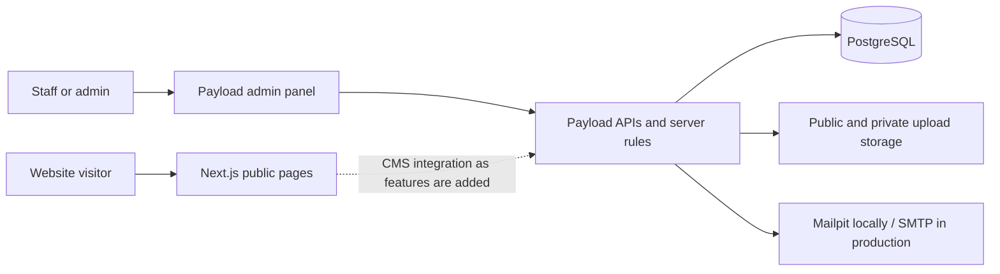
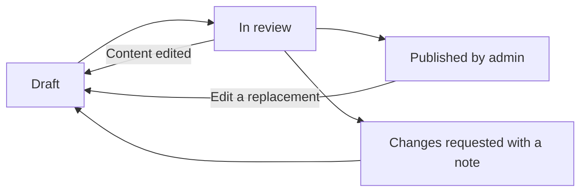

# Payload handbook for the Pazelgreen team

Start here if you have never used Payload. This guide explains what the parts do,
why the setup steps exist, and how to work locally and operate a deployed site.
Keep the [command reference](cms-setup.md) open when following the instructions.

This describes the **T01–T03 foundation**, checked against this repository on
**7 November 2026**: Payload 3.93.0, Next.js 16.3.3, Node 24.22.2, and pnpm 10.18.1.
Online tutorials may describe different versions or different access rules.
Our configuration and tests determine how this project behaves.

If you are learning the system, read the concepts and local setup first. Editors
of a hosted site can go to [Using the admin panel](#using-the-admin-panel).
Developers should also read [Developer workflow](#developer-workflow); the person
deploying the site needs [Running in production](#running-in-production) and
[Backups and recovery](#backups-and-recovery).

## Contents

- [What Payload is](#what-payload-is)
- [The parts of this project](#the-parts-of-this-project)
- [What is available today](#what-is-available-today)
- [Who does what](#who-does-what)
- [First local setup](#first-local-setup)
- [Everyday local development](#everyday-local-development)
- [Using the admin panel](#using-the-admin-panel)
- [Understanding environment variables](#understanding-environment-variables)
- [Developer workflow](#developer-workflow)
- [Running in production](#running-in-production)
- [Backups and recovery](#backups-and-recovery)
- [Working as a team](#working-as-a-team)
- [Troubleshooting](#troubleshooting)
- [Common questions](#common-questions)

## What Payload is

A content management system (CMS) lets authorized people maintain structured
content through an admin interface. Payload is configured in TypeScript: developers
define the fields and behavior, and Payload builds the admin screens and APIs from
that configuration. Its entry point here is [payload.config.ts](../payload.config.ts).
See the official [configuration guide](https://payloadcms.com/docs/configuration/overview).

For example, a developer can define a post with a title, body, cover image, and
publication status. An editor can then write posts without changing React files.
**Posts are an example of the model; our blog feature is still planned.**

The public website remains a Next.js application. Its components decide where and
how CMS data appears. Adding a field to Payload does not automatically put that
field on a public page, and uploading an image does not replace the homepage image.

There are two different kinds of change:

| Change | Where it happens | What the team does |
| --- | --- | --- |
| Edit content using fields that already exist | Admin panel; saved in the database | Save a draft and follow the review process |
| Add fields, change permissions, or change the website layout | TypeScript/React/CSS in Git | Review code, test it, migrate the database if needed, and deploy |

Payload runs **inside this Next.js application**. We do not start a separate
Payload server. You do not need a Payload Cloud account to run this repository
locally. Hosting is a separate choice; Payload supports self-hosted deployments.
See [deployment options](https://payloadcms.com/docs/production/deployment).

### Vocabulary you will encounter

| Term | Meaning in practice |
| --- | --- |
| Collection | A set of records with the same fields, such as users or images. [Payload collections](https://payloadcms.com/docs/configuration/collections) |
| Document | One record in a collection, such as one image with its alt text |
| Field / schema | A piece of data / the definition of the fields and their rules |
| Global | One shared document, useful for company settings rather than many independent records. Globals are planned here. [Payload globals](https://payloadcms.com/docs/configuration/globals) |
| Slug | A stable identifier used in code or URLs, such as the collection slug `media` |
| Relationship | A link from one record to another, such as a future post referring to an image |
| Hook | Server code that runs around an operation; we use hooks to enforce review and record audit events |
| Access control | Server rules deciding who may read, create, update, or delete data |
| Draft / published version | Work in progress / the approved content available to public readers |
| Migration | A reviewed change to the database structure, recorded as code |
| Adapter | The connection between Payload and a database, email service, or storage system |

## The parts of this project



| Part | What it holds or does | Local location |
| --- | --- | --- |
| Next.js + Payload | Website, admin, APIs, validation, permissions and review rules | Runs on your computer with `pnpm dev`; port 3000 by default |
| PostgreSQL | Users, passwords in hashed form, sessions, invitations, content records, file metadata, versions and audit events | Docker container; host port 5433 |
| Public upload storage | Image files intended for public use after approval | `storage/public/` |
| Private upload storage | Restricted PDF/DOCX files | `storage/private/` |
| Mailpit | Captures development emails so you can inspect invitation/reset links | Docker container; inbox on port 8025, SMTP on 1025 |
| Git repository | Application code, schema definitions, migrations, tests and documentation | This checkout |

An upload has **two parts**: a database record describing it and the actual file
bytes in storage. Losing either part can break the upload. Upload-enabled
collections manage that metadata and file handling; see [Payload uploads](https://payloadcms.com/docs/upload/overview).

Docker gives everyone a repeatable local PostgreSQL and email environment.
In our setup, Docker runs those two services; Node runs the website and Payload.
The database and Mailpit use named Docker volumes, while upload files live in
directories on your computer. Stopping a container normally preserves its volume.

**Git is not a database or upload backup.** Committing and pushing this repository
does not copy your local users, content, emails, or uploaded files to a teammate.

## What is available today

| Available in the committed foundation | Still planned |
| --- | --- |
| Public Home, About, Solutions, Join Us and Contact pages | CMS-backed company details and page SEO: T04 |
| `/admin`, admin/staff users and invitations | Blog/categories and public blog pages: T05 |
| Image media library with review and version history | Jobs, code dictionaries and careers pages: T06 |
| Restricted PDF/DOCX storage infrastructure | Candidate applications, full CV workflow and recruitment emails: T07 |
| Audit events, protected media JSON preview and SQL migrations | Backend-only FAQs: T08; announcements: T09; legal pages: T10 |
| Local Docker services and automated checks | Further caching, operations and launch acceptance work: T11–T12 |

Most marketing content is still written directly in frontend components. Do not
expect company settings, a blog editor, vacancies, or application records to appear
in the current admin panel. Contact-message delivery and newsletter integration
are outside this CMS scope. Homepage content editing is excluded from the plan.
The [task plan](../.planning/task.md) and [progress record](../.planning/progress.md)
track what has actually been delivered.

## Who does what

| Person | Responsibilities |
| --- | --- |
| Developer | Changes code and schemas; maintains access rules, migrations and tests |
| Staff member | Creates/edits drafts, submits them for review, and reads permitted private records |
| CMS administrator | Reviews and publishes content, unpublishes it, and manages invitations/users |
| Deployment operator | Configures hosting, secrets, database, storage, email, releases and recovery |

One person can have several responsibilities. A CMS admin role does not grant
access to the server, GitHub repository, database hosting account, or billing.
Those permissions are managed separately.

Editors who only use a hosted `/admin` need its URL and an invited account. They
do not need to clone the repository or install Node/Docker. The local setup below
is for teammates who want to run or develop the whole application on their machine.

Our two CMS roles are **admin** and **staff**. Staff can update their own profile,
but cannot grant themselves admin status, manage other users, or publish content.
Admins can deactivate users; prefer this to deleting them. Role changes and
deactivation clear sessions. The final active admin cannot be removed, deactivated,
or demoted. Audit records preserve identifiers after a user is deleted.
These are Pazelgreen rules implemented in [users.ts](../cms/users.ts), not a
universal role system supplied automatically by every Payload installation.

## First local setup

### 1. Prepare your tools

Use Node **24.22.2**, pnpm **10.18.1**, and Docker Desktop with Compose available.
Start Docker Desktop before starting the application. Check your terminal:

```sh
node --version
pnpm --version
docker --version
docker compose version
```

Node runs Next.js/Payload and the setup scripts. pnpm installs the project's
dependencies. Docker Compose starts the database and email services.
The runtime pin is in [`.node-version`](../.node-version); the dependency and
package-manager requirements are in [package.json](../package.json).
A `.node-version` file does not itself install Node: select it using your Node
version manager, or install that version, then reopen the terminal if necessary.

### 2. Clone and install

```sh
git clone git@github.com:Pazelgreen-Technologies-Limited/pazelgreen-website.git
cd pazelgreen-website
pnpm install --frozen-lockfile
```

Use the HTTPS clone URL from GitHub if your SSH access is not configured.
The lockfile makes teammates install the reviewed dependency versions.
You do not need to install Payload globally or create another Next.js project.

### 3. Configure your own local environment

On a **new checkout**, copy `.env.example` to `.env`. In PowerShell:

```powershell
Copy-Item .env.example .env
```

If `.env` already exists, edit it instead of overwriting it. It may already contain
the working password for an initialized local database.

Set `APP_ENV=development`. Choose a local `POSTGRES_PASSWORD` and put the same
password in `DEV_DATABASE_URL`. The example uses database/user `pazelgreen` and
host `127.0.0.1:5433`; keep those values aligned with the Compose variables.
The application's URL password must be URL-encoded if it contains special
characters. A random hexadecimal password avoids that encoding issue.

Generate a random value locally with:

```sh
node -e "console.log(require('node:crypto').randomBytes(48).toString('hex'))"
```

Generate **separate values** for the database password and `PAYLOAD_SECRET`, and
paste them into your untracked `.env`. The command prints a secret to your own
terminal; do not paste that output into Git, chat, tickets, or this handbook.
Keep `SERVER_URL=http://localhost:3000` for the default development server.

| Credential | Purpose | Used by |
| --- | --- | --- |
| PostgreSQL password | Allows the app to connect to the database | Compose and the selected database URL |
| `PAYLOAD_SECRET` | Server secret used by Payload for authentication/cryptographic operations | The application; minimum 32 characters here |
| Administrator password | Lets a person sign in to `/admin` | That person's CMS account |

These credentials are different. Changing one does not change the others.
Never prefix a server secret or database URL with `NEXT_PUBLIC_`.

### 4. Start the app and initialize the schema

```sh
pnpm dev
```

Leave this terminal running. The `predev` script runs before Next.js:

1. It checks that `APP_ENV` is `development`.
2. It starts PostgreSQL and Mailpit with `docker compose up -d --wait`.
3. It applies pending committed migrations with `payload migrate`.
4. Next.js starts the website, admin and APIs.

Migrations create the database tables that Payload needs; starting a PostgreSQL
container alone does not create our application schema. Starting the app does not
create a CMS administrator or seed public content.

| Address | Use |
| --- | --- |
| `http://localhost:3000` | Public website |
| `http://localhost:3000/admin` | CMS admin |
| `http://localhost:8025` | Development email inbox |

The first container-image download can take longer than later starts. If port
3000 is occupied and Next chooses another port, use a free port consistently and
update `SERVER_URL` to match; invitation links and allowed origins depend on it.

### 5. Create the first administrator once

Our public signup and default first-user registration API are blocked. Otherwise,
the first visitor to a new deployment could try to claim its administrator account.
We create the first administrator from a trusted terminal instead.

After the database has started and migrations have finished, temporarily add these
values to your local `.env`:

```dotenv
BOOTSTRAP_ADMIN_EMAIL=your-own-email@example.com
BOOTSTRAP_ADMIN_PASSWORD=replace-with-your-own-strong-password
```

Use your real chosen email and a unique password of **12–256 characters**; the
values above are placeholders. In a second terminal in this project, run:

```sh
pnpm cms:bootstrap
```

The command creates one active admin only when the users collection is empty.
It refuses later setup attempts. Remove both bootstrap variables from `.env`
after success, then sign in at `/admin` with the email/password you selected.
Removing the variables does **not** delete the account: it is stored in PostgreSQL.

You do this **once per independent database**, not once per server restart or Git
branch. Each developer with their own local database can create their own admin.
For a shared environment that already has users, ask an admin for an invitation.

If you prefer to bootstrap before starting Next.js, run `pnpm db:up`, then
`pnpm cms:migrate`, then the bootstrap command. All three use the same `.env`.

## Everyday local development

After initial setup, the normal start is just:

```sh
pnpm dev
```

Press **Ctrl+C** in its terminal to stop Next.js. The Docker services keep running
so the database stays available. To stop them too:

```sh
pnpm db:stop
```

Start them again with `pnpm db:up`, or let the next `pnpm dev` do it. These stop/start
operations preserve the database and inbox volumes. Your uploaded files remain in
`storage/`. Deleting a Docker volume or those directories is a different operation
that can lose data; it is not part of ordinary startup or troubleshooting.

After pulling a teammate's changes, run `pnpm install --frozen-lockfile` if the
dependencies changed, then `pnpm dev`. Its migration step brings your database
structure up to date. It does not copy your teammate's content or accounts.

### Local email

Mailpit captures email sent by the app; it does **not** deliver it to a real inbox.
To test an invitation or password reset, open port 8025 and follow its link there.
The default link points to localhost, so it opens the app on the machine viewing
the link. Sharing that link with a colleague does not give them access to your
laptop's app. Use an intentionally hosted shared environment for shared testing.

### A local production build

To check optimized production-mode application behavior while keeping local data:

```sh
pnpm db:up
pnpm cms:migrate
pnpm build
pnpm start
```

Keep `APP_ENV=development` in your local `.env` for this exercise. `build` creates
the optimized application; `start` serves that build and does not start Docker or
apply migrations. Stop `pnpm dev` first if it is using the same port. This exercise
does not deploy anything or connect to the real production database.

## Using the admin panel

### Invite a teammate

An admin opens **Invitations**, creates a record with the person's name, email and
role, and saves it. The app emails a single-use activation link, valid for 24 hours.
The recipient chooses their own password and then signs in. Only the token hash
is stored, and redemption creates the account atomically. Email links are sensitive;
do not put them into screenshots or shared issue descriptions.

If an invitation expires, delete the unused invitation and create a fresh one.
Deleting an unused invitation revokes it. An account that already exists should
use password reset or administrator assistance instead of another invitation.
If invitation email delivery fails, creation rolls back; restore the email service
and retry. In production, check the actual recipient's mailbox and spam folder.

Use **Users** to deactivate someone who leaves the team. This blocks access and
clears their sessions while retaining their account for attribution. Do not share
a single administrator login among the team.

Use the login page's password-reset flow if you forget a password. Reset emails
go to Mailpit locally or the configured email service in production; the current
reset-link expiry is one hour. A password reset does not reactivate a deactivated
account. Failed logins can temporarily lock an account (five attempts, ten-minute
lock time). If access still fails, contact an admin/operator rather than deleting
users or clearing the database to repeat setup.

### Save, submit, review, publish

Payload supports drafts and versions. Our additional review rules live in
[workflow.ts](../cms/workflow.ts). See the underlying [Payload draft model](https://payloadcms.com/docs/versions/drafts).



For a current media record:

1. Upload a JPEG, PNG or WebP image and write useful alt text. Add a caption or
   attribution if needed. Save the draft.
2. When the content is ready, set **reviewState** to **in-review** and save the
   draft again without changing its content.
3. An admin reads that submitted draft. They either use **Publish** on the
   unchanged draft, or set **changes-requested**, supply a review note, and save
   the draft. Review notes are private to CMS users.
4. If someone edits the content after submission, it returns to **draft** and
   must be submitted again. Save revisions before resubmitting them.

There are two related fields: `_status` tracks Payload draft/publication storage;
`reviewState` tracks our approval process. Selecting a value named "published"
in a review dropdown does not bypass approval or replace the Publish action.
The server enforces these rules even when a caller uses the API instead of the UI.

Editing a published document creates a replacement draft while the approved
version remains available publicly. An admin can **Unpublish** it to withdraw
public access while keeping the record and version history. **Delete** can remove
the record and associated files/history; use Unpublish when you need to retain it.
Direct version restoration is blocked here: copy the historical values into a
draft and submit them for review. Review updates happen one document at a time;
bulk updates are blocked by the current workflow.

Current preview is authenticated JSON at `/api/preview/media/<id>`; it is not yet
a visual blog/careers preview. A browser without a valid staff/admin session
cannot use that endpoint. Future frontend preview routes belong to those features.

### Public images and private files

All uploads currently have a **5 MB** limit. The `media` collection accepts JPEG,
PNG and WebP. Replacing the bytes of an existing image is blocked: upload a new
media record so an already approved file URL cannot silently change its contents.
An approved media record being available through the API does not mean a public
page already references it.

The `private-files` collection accepts PDF/DOCX as storage infrastructure. Only
admins currently create, update or delete these files; active staff/admins can
read/download them. It is not yet a candidate application system. Keep private
documents out of `media`, Next's `public/` folder, and public links.

Both upload directories are outside Next's static `public/` directory and files
are served through Payload access checks. Current file responses use
`private, no-store` caching, including media, so authenticated draft responses
are not shared through a public cache.

## Understanding environment variables

An environment variable supplies configuration to a process without hardcoding
it into application code. Local values usually live in the ignored `.env` file;
deployed values belong in the hosting platform's environment/secret settings.
The tracked `.env.example` documents the names and contains placeholders.

### APP_ENV and NODE_ENV answer different questions

| Setting | Question it answers |
| --- | --- |
| `NODE_ENV` | Is Next.js running its development server, optimized production code, or tests? |
| `APP_ENV` | Which deployment's database and service configuration should our app use? |

Next sets `NODE_ENV=production` for a build even on your laptop. That is why we
have a separate `APP_ENV`: a local optimized build should still use Docker.
Next's environment-file loading follows `NODE_ENV`, not `APP_ENV`; there is no
automatic `.env.<APP_ENV>` convention in our code. Shell/hosting environment values
take precedence over file values. See [Next environment variables](https://nextjs.org/docs/app/guides/environment-variables).

| `APP_ENV` | Selected database variable | Intended use |
| --- | --- | --- |
| `development` | `DEV_DATABASE_URL` | Local Docker database |
| `test` | `TEST_DATABASE_URL` | Separate disposable test database |
| `production` | `PRODUCTION_DATABASE_URL` | Database explicitly configured for the hosted deployment |

Set `APP_ENV` explicitly. When absent, production `NODE_ENV` selects production;
other runtimes default to development. Unknown values such as `staging` are
rejected. A hosted staging deployment can use `APP_ENV=production` with its **own**
database, storage, origin and secrets; its `PRODUCTION_DATABASE_URL` value must
point to staging's database, not the live site's database.

Changing `APP_ENV` selects a connection. It does not provision a database, move
content, create an admin, or deploy the site. There is no production fallback to
the Docker URL. The old `DATABASE_URL`, `NEXT_PUBLIC_API_URL`, and
`SKIP_ENV_VALIDATION` are not configuration shortcuts for the current CMS.
Restart processes after changing environment values.

### Variable reference

| Variable | What to set and why |
| --- | --- |
| `APP_ENV` | Explicit environment from the table above |
| `POSTGRES_DB`, `POSTGRES_USER`, `POSTGRES_PASSWORD` | Initial credentials/database for our local Docker service |
| `POSTGRES_PORT` | Host-side Docker database port; default 5433, container port remains 5432 |
| `DEV_DATABASE_URL` | Local connection from Node on your computer; match the Compose credentials/port |
| `TEST_DATABASE_URL` | Separate local database ending in `_test`; tests reset its CMS records |
| `PRODUCTION_DATABASE_URL` | Hosted database URL supplied by the operator; never the local Docker address |
| `PAYLOAD_SECRET` | Random server secret of at least 32 characters; keep stable across restarts and replicas of the same environment |
| `SERVER_URL` | Browser-facing origin used for links and allowed origins; localhost for local work, HTTPS in production |
| `PUBLIC_UPLOAD_DIR`, `PRIVATE_UPLOAD_DIR` | Local defaults are `storage/public` and `storage/private`; production requires absolute, persistent, separate paths outside `public/` |
| `SMTP_HOST`, `SMTP_PORT`, `SMTP_SECURE` | Mailpit locally: `127.0.0.1`, `1025`, `false`; provider-specific values in production |
| `SMTP_USER`, `SMTP_PASSWORD` | Production SMTP login; blank for local Mailpit |
| `EMAIL_FROM_ADDRESS` | Local default `cms@pazelgreen.test`; verified sending address in production |
| `BOOTSTRAP_ADMIN_EMAIL`, `BOOTSTRAP_ADMIN_PASSWORD` | Temporary first-admin CLI inputs; remove after setup |

Port 465 commonly uses implicit TLS (`SMTP_SECURE=true`); port 587 commonly uses
STARTTLS (`SMTP_SECURE=false`). Here, false disables implicit TLS, not necessarily
STARTTLS. Use the mail provider's settings and verify delivery/TLS behavior.
The production default is port 465 with secure enabled if you do not override it.
See the [Nodemailer SMTP settings](https://nodemailer.com/smtp) for how implicit TLS
and STARTTLS differ.

Postgres environment values initialize a **new** Docker data volume. Editing
`POSTGRES_PASSWORD` later does not change an existing database user's password.
Likewise, changing the app's URL alone does not change the database role. Coordinate
password rotation in Postgres and in the application configuration.
The [official Postgres image documentation](https://hub.docker.com/_/postgres)
describes the initial-volume behavior of its environment variables.

## Developer workflow

### Find the right files

| Path | Responsibility |
| --- | --- |
| `payload.config.ts` | Registers collections, database, storage, email, editor, origins and types |
| `cms/` | Collection definitions, access rules, hooks, transactions and custom endpoints |
| `app/(frontend)/` | Public pages and their colocated `_components/` folders |
| `app/(payload)/` | Admin/API integration and isolated admin layout/styles |
| `components/` | UI shared across distinct public pages |
| `migrations/` | Committed database changes and schema snapshots |
| `payload-types.ts` | Generated TypeScript types for records and Local API calls |
| `app/(payload)/admin/importMap.js` | Generated admin-component import mapping |
| `tests/`, `.github/workflows/ci.yml` | Verification and CI |

Parenthesized route groups do not change public URLs. Underscore-prefixed
`_components` folders hold page-specific UI and are not routes. Follow the
repository's [agent/contributor rules](../AGENTS.md) and read the relevant installed
Next.js guides before changing application code.

### Database schema changes and migrations

Suppose you add a field to a collection. Changing TypeScript tells Payload the
desired shape, but PostgreSQL also needs the matching table/column change.
Our adapter has `push: false`, so we use explicit migrations in local development
as well as production. Do not follow tutorials that mix automatic schema push
with manual migrations in this repository.

```sh
pnpm cms:types
pnpm cms:importmap
pnpm cms:migration:create describe_the_schema_change
pnpm cms:migrate
```

The first two commands refresh generated types/admin imports. The third writes
migration files for review; it does not apply the migration. The fourth applies
pending migrations to the database selected by `APP_ENV`. Commands must succeed
before continuing; inspect generated SQL, especially anything that deletes data.
Keep the generated TS, JSON snapshot, migration index, types and import-map changes
in the PR as applicable. Type generation alone does not migrate a database.
The migration TS contains executable changes; the JSON snapshot helps generate
the next schema diff. Keep both when the generator produces them. A label-only or
permission-only code change may not need a database migration; check the actual
schema difference instead of inventing an empty migration for every edit.

`pnpm exec payload migrate:status` shows applied/pending migrations. Already applied
migrations are recorded in the database, so `pnpm dev` normally skips them. Keep
existing migrations append-only; add a new one rather than editing a migration
that teammates or production have already applied. Preserve the custom last-admin
trigger migration. Editing content in the admin does not require a schema migration.
The official [migration reference](https://payloadcms.com/docs/database/migrations)
explains the CLI; use our scripts and disabled-push policy when following it.

If branches contain competing schema changes, coordinate their order and snapshots
before merging. Renaming a field may need an explicit data migration to preserve
values. Do not accept a generated drop/recreate as a harmless rename.

### Reading content in server code or over HTTP

Payload has a Local API for calling it directly from server code, and generated
REST endpoints for HTTP callers. This project disables GraphQL, although its
package is installed to satisfy Payload's dependencies.

**In our pinned Payload 3 release, Local API calls bypass access control by default.**
Pass `overrideAccess: false` for public/user-facing operations, and pass the
authenticated user for protected operations. This is verified against the
[version-matched Local API documentation](https://github.com/payloadcms/payload/blob/v3.93.0/docs/local-api/access-control.mdx)
and installed package; a newer major version may have a different default.

For example, this is a read-only query for publicly readable, approved media:

```ts
import config from '@payload-config'
import { getPayload } from 'payload'

const payload = await getPayload({ config })
const media = await payload.find({
  collection: 'media',
  draft: false,
  overrideAccess: false,
  limit: 10,
})
```

Do not call the Local API from a browser component. Use trusted server code or
the HTTP API. `GET /api/media` is a current public REST example; user/private-file
endpoints require the appropriate session. See the [REST guide](https://payloadcms.com/docs/rest-api/overview)
and our [custom endpoint contract](cms-api.yaml). Never send a database URL or
PAYLOAD_SECRET to a browser to "authenticate" it.

Bypassing access in a controlled bootstrap/migration is different from bypassing
access in a public page. Direct database writes also bypass Payload hooks; do not
use them as the normal way to publish content or manage accounts.

### Checks before a PR

With Docker running and the test database configured:

```sh
pnpm lint
pnpm typecheck
pnpm test
pnpm test:integration
pnpm build
pnpm test:http
```

Run these in order and stop to fix failures. Integration tests apply migrations,
reset CMS records in the disposable database, and send test email to Mailpit.
HTTP tests require those fixtures and a fresh production build; they start a
temporary server on `127.0.0.1:3101`, use test uploads, then stop it.
See [test database setup](cms-setup.md#test-database-and-checks) before the first run.
The test helpers refuse non-local database URLs or names without an `_test` suffix;
you must still supply a genuinely disposable database.

## Running in production

Production is the environment real visitors and editors depend on. Your laptop's
Compose services are not a production deployment. Switching the environment flag
alone cannot make the site publicly hosted or make data durable on a hosting platform.

### Decide who owns each service

Before the first release, the team must name an operator and configure:

| Requirement | What must be ready |
| --- | --- |
| Application hosting | A supported Node runtime running the built Next.js/Payload app, reachable by domain over HTTPS |
| PostgreSQL | An independently provisioned production database, credentials, network access, TLS configuration, backups and recovery |
| Public/private storage | Two persistent mounted paths with app read/write permissions, or a deliberately implemented storage adapter |
| Email | Production SMTP service, verified sender/domain, credentials and tested delivery |
| Release process | A job/process capable of applying migrations using the correct deployment environment |
| Operations | Owners for logs, uptime, storage capacity, backups, recovery and access removal |

The current implementation supports persistent filesystem storage. An ephemeral
filesystem can lose uploads on redeploy/restart, even if PostgreSQL survives.
Before choosing serverless/ephemeral hosting, implement an appropriate storage
adapter and preserve private download checks. With multiple app replicas, all
replicas need access to the same uploaded files and the same environment secret.
The general [Payload deployment guide](https://payloadcms.com/docs/production/deployment)
describes the hosting pieces; our storage configuration is more specific.

No production provider has been chosen or provisioned by the CMS foundation.
Keep those decisions and the remaining launch work visible in the task plan.
The database account used for migrations needs permission to change its schema;
the runtime account needs the application's required data permissions. Have the
operator configure appropriate credentials and privileges for each job rather
than assuming a read-only database login can run migrations.

### Configure the deployed environment

Set these in the platform's secret/environment settings, available to the build,
migration job and running server as needed:

```dotenv
APP_ENV=production
PRODUCTION_DATABASE_URL=<provider-supplied-postgres-url>
PAYLOAD_SECRET=<unique-stable-random-secret-for-this-environment>
SERVER_URL=https://<your-public-hostname>
PUBLIC_UPLOAD_DIR=<absolute-path-to-persistent-public-upload-mount>
PRIVATE_UPLOAD_DIR=<absolute-path-to-persistent-private-upload-mount>
SMTP_HOST=<provider-smtp-host>
SMTP_PORT=<provider-smtp-port>
SMTP_SECURE=<true-for-implicit-tls-or-false-for-starttls>
SMTP_USER=<smtp-username>
SMTP_PASSWORD=<smtp-password>
EMAIL_FROM_ADDRESS=<verified-sender-address>
```

These are placeholders, not a runnable deployment file. Use independent secrets
for local work, staging and production. Do not deploy your local `.env` or Mailpit
as the production email service. Production validation rejects missing required
values, HTTP origins, relative/overlapping storage paths, and the specifically
blocked local database hosts in [env.ts](../env.ts). That validation does not prove
a database is the correct one: the operator must verify its identity and access.
Keep database certificate validation enabled and follow the provider's TLS setup.

Keep PAYLOAD_SECRET stable across restarts/deployments. Plan secret rotation as an
operational change because it affects authentication; it is not an admin password
reset. Store recoverable copies of required secrets in the team's approved secret
manager, separately from Git.

`SERVER_URL` must match the real external origin and the proxy must support HTTPS
and the app's cookies. If you add another hostname or a separate frontend origin,
review the configured CORS/CSRF origins instead of opening them to every website.

### First production deployment

1. Verify the independent production database, SMTP service and persistent mounts.
   Use a clean database; do not copy test accounts or personal local records into it.
2. Install locked dependencies and build the reviewed release with supported Node.
   Supply valid production configuration; do not disable validation to hide errors.
3. Back up any existing data and apply `pnpm cms:migrate` in a controlled release
   job against the production database. Inspect migration status and failures.
4. For an empty users collection, provide first-admin credentials securely to that
   environment's CLI and run `pnpm cms:bootstrap` once. Remove those inputs afterward.
5. Start the built application with `pnpm start` under the hosting platform's process
   supervision, then verify public pages and `/admin` through the HTTPS hostname.
6. Test an invitation/reset email, an approved image, and a private file download;
   verify anonymous/private/draft access is denied. Remove temporary acceptance data.
7. Confirm backups and an isolated restore test, and complete the launch checks.

`pnpm start` does not install dependencies, build, start Docker, create users, or
apply migrations. Our Docker helper scripts refuse `APP_ENV=production`.
Use `pnpm start` for the deployed app; `pnpm dev` is a local development workflow.
Follow the host's process management rather than leaving an interactive shell open.

The current marketing-page build can succeed without proving database/email/file
service health. SMTP startup verification is skipped in our adapter, so a successful
boot is not proof that email works. Later CMS-backed pages may fetch data during
builds; revisit database availability and build/migration ordering as those routes
are implemented.

### Subsequent releases

Review the change, run CI, build an artifact, and rehearse migrations in a separate
staging environment. Coordinate migrations with the running app: an additive change
can often coexist with the old code, while an incompatible change may require a
maintenance window or a staged rollout. Take an appropriate backup before data
changes and run migrations once in a release job, not concurrently on every replica.

A code rollback does not automatically roll back the database. Decide whether the
old code is compatible with the new schema before switching back. Prefer a reviewed
forward fix when reversing a migration would lose data. Do not run reset/fresh/down
commands against production as a routine recovery action.

Editors can continue maintaining existing content without a schema deployment.
Whether a page immediately shows an approved change depends on its CMS integration
and cache invalidation. Those remaining frontend/cache tasks are tracked in the plan.

## Backups and recovery

Back up the **database and both upload stores**. PostgreSQL includes account,
content, version, audit and file-metadata records; its backup alone does not contain
the file bytes in our filesystem setup. Back up required configuration/secrets
through the approved secret manager, and retain the matching release/migration code.

Use your database provider's backup/point-in-time recovery or an operator-managed
Postgres backup process. Protect copies of private files and database dumps as
sensitive data. Keep backups outside this repository and outside the same single
failure point as the live service. A Docker volume or Git commit is not that backup.

The operator should document frequency, retention, who can restore, and the
acceptable amount of lost work/downtime. Coordinate database and file snapshots
so restored metadata matches the restored files. Pause writes or use a suitable
consistent snapshot strategy when needed.

Rehearse recovery in an isolated environment: restore the database and files,
restore that environment's configuration, start a compatible app version, and check
login, published data, denied private access, and file downloads. Prevent the restored
environment from emailing real users or receiving public traffic. Record the result.
Do not overwrite the live database just to find out whether a backup works.

## Working as a team

Use individual CMS accounts and individual repository/hosting access. Decide who
reviews content and who operates releases. Editors should not need database
credentials to do their daily work.

| Shared through Git/PRs | Shared through controlled services | Kept out of Git |
| --- | --- | --- |
| Code, schemas, migrations and snapshots, generated types/import map, tests, docs, `.env.example` | Approved production content through the deployed CMS; credentials through the secret manager | `.env*` secrets, real bootstrap passwords, activation links, uploads, database dumps and applicant data |

The `.env.example` file is deliberately tracked; actual secret-bearing `.env`
files and `storage/` are ignored. Test fixtures use artificial identities and
credentials only. Never reuse their passwords for real accounts.

Each laptop normally has its own database and files. A shared staging environment
needs its own services and user invitations. Branch switching changes code, not
the database back in time; schema changes may remain after you switch branches.
Coordinate migrations or use separate disposable databases for incompatible work.

For a handoff, record code/schema changes, migration order, checks actually run,
remaining blockers and the next task. Keep onboarding/operations knowledge in this
handbook, commands in the runbook, and implementation status in `.planning/`.
Update them when behavior changes. Ask the team before importing/exporting a real
dataset between environments; use approved, appropriately sanitized data.

## Troubleshooting

| Symptom | What it usually means | First action |
| --- | --- | --- |
| Node version/engine error | The terminal is using a different Node installation | Run `node --version`; select `.node-version` and reopen the terminal |
| Docker daemon/pipe unavailable | Docker Desktop is stopped or this user cannot access it | Start Docker Desktop; verify `docker compose ps` from the project |
| Connection refused on 5433 | Database is not running or the configured port differs | Run `pnpm db:up`; compare `POSTGRES_PORT` and `DEV_DATABASE_URL` |
| PostgreSQL password authentication fails | URL credentials do not match the initialized role | Check the selected URL; changing `.env` does not rotate an existing database password |
| Missing table/column | Migrations have not been applied, or code/DB revisions differ | Check environment, then `pnpm exec payload migrate:status` and `pnpm cms:migrate` |
| Missing production URL/settings | APP_ENV is production, but deployment configuration is incomplete | Supply that deployment's values; do not work around it by selecting development on a live host |
| Bootstrap says users already exist | The database has already been initialized | Sign in/reset your password or ask an existing admin for an invitation |
| Initial setup page appears | No CMS users exist in the selected DB | Confirm the environment, then run the trusted bootstrap procedure |
| Login is blocked | Wrong password, inactive account, or temporary lockout | Ask an admin to check status; current limit is five failed attempts with a ten-minute lock time |
| Invitation/reset email is missing locally | Development emails are captured, not delivered | Open Mailpit on port 8025 and check its latest messages |
| Email link opens the wrong app | SERVER_URL differs from the browser-facing origin | Correct the environment value and create a fresh invitation/link |
| Invitation expired or already used | Its 24-hour/single-use condition has been reached | Ask an admin for a fresh invitation if no account was created |
| Publish returns a conflict | The draft was not submitted, or content changed during/after review | Save changes, submit the unchanged draft, then have an admin publish |
| API returns 403 | Authentication/role/access rules denied the request | Use the correct account/session; do not loosen access rules to silence it |
| Public record returns 404 | No matching publicly readable record exists | Check ID, publication state and environment; private/draft content may deliberately be unavailable |
| Upload rejected | File exceeds 5 MB or fails allowed type/content checks | Use the allowed format; image replacement needs a new record |
| File missing after redeploy | Filesystem was ephemeral, a mount is wrong, or only the DB was restored | Check persistent mount paths and matching file backups |
| Saved content does not change a public page | It is a draft, the page is still hardcoded, or cache integration is pending | Check publication, the page's actual data source and current task status |
| Test DB guard rejects the URL | Test helpers refuse the requested database | Create a separate local `_test` database; never point tests at meaningful data |
| HTTP tests cannot sign in/find fixtures | Integration fixtures are absent or the build is stale | Run integration tests successfully, then build, then HTTP checks |
| Build cannot fetch Google fonts | This site's font downloads cannot reach Google | Restore build-time network access; this is separate from Payload's database setup |

For service diagnostics, `docker compose ps` and
`docker compose logs --tail 50 postgres` can help. Check which environment you are
using before running repair commands. Share the failing command and a redacted
error message; do not share `.env`, session tokens, passwords or private documents.

## Common questions

**Do I run bootstrap every morning?** No. Your account survives app/container
restarts as long as its database data survives.

**Does an admin account on localhost work in production?** Only if it also exists
in that separate database. Bootstrap the first production admin once, or ask that
environment's existing admin for an invitation.

**Does pushing code publish my local content?** No. Code deployments and content
storage are independent. Production editors work in the production CMS.

**Can I use the admin without a database?** The full CMS needs its database.
Some current public marketing pages can build/render independently because their
content is hardcoded; that does not make an operational CMS database optional.

**Do all editors need Docker and Node?** No. Editors using a hosted CMS need its
URL and their account. People running the whole project locally need those tools.

**Can I publish only static HTML files to run the CMS?** No. The admin, API,
authentication and database operations need a running server. A successful build
of static marketing pages does not replace the Next.js/Payload server.

**Does Payload automatically provide our approval process?** It provides building
blocks such as access rules, hooks and versions. Our specific roles, invitations,
last-admin protection and approval requirements are implemented in this repository.

**Can the public submit CVs now?** Not through a completed application feature.
Private storage exists, but public applications, candidate validation, notifications
and retention handling are planned in T07.

**What should we do next?** Finish your local account setup and inspect the admin.
The next planned implementation is T04: shared company settings and SEO for existing
public pages. Production hosting, real content, approved policies and the remaining
feature/launch tasks must be completed before treating this foundation as launch-ready.
